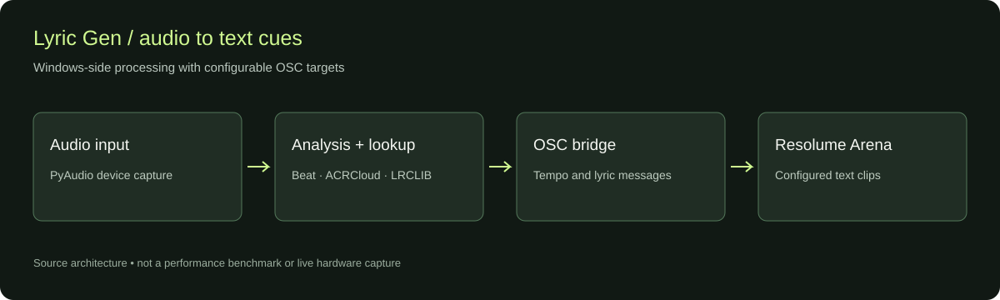

# Lyric Gen Beta (1.0.0-beta.1)

Lyric Gen is a Windows sidecar for Resolume Arena that sends beat/tempo and synced lyric text over OSC for live VJ sets.



*Architecture diagram based on the current modules. It is not a live performance capture or an accuracy benchmark.*

## What this beta includes

- Real-time BPM and beat pulse output over OSC
- Song ID using ACRCloud (bring your own keys)
- Synced lyric fetch from LRCLIB
- Current and next lyric text output to Resolume text sources/effects
- GUI preferences for Resolume routing, song ID credentials, and audio input
- Manual lyric timing controls and rescan workflow

## System requirements

- Windows 10 or Windows 11
- Python 3.10+ (`3.11` recommended)
- Resolume Arena on the same machine or reachable over network
- Internet access for ACRCloud and LRCLIB APIs
- Optional: ACRCloud project credentials for automatic song ID

## Run from source

The repository contains the Python app and launcher. An installer and its build recipe are not included in this source snapshot; start from a clone using the commands below.

```powershell
git clone https://github.com/icaruslastflight/lyric-gen.git
cd lyric-gen
py -3.11 -m venv .venv
.\.venv\Scripts\python.exe -m pip install -r requirements-min.txt
.\.venv\Scripts\python.exe run.py
```

The window can be opened before connecting Resolume or supplying recognition credentials. Configure your targets before pressing **START**. The launcher `Lyric Gen.bat` uses this local virtual environment when present.

Optional experimental tempo analysis:

```powershell
.\.venv\Scripts\python.exe -m pip install -r requirements-full.txt
```

GUI preferences are stored in `%APPDATA%\LyricGen\preferences.json`. Keep recognition credentials in that local file; do not add it to Git.

## First-time Resolume setup

Detailed guide: [Resolume setup](docs/SETUP_RESOLUME.md)

Quick version:

1. Create two text clips in Resolume (current line and next line).
2. In Lyric Gen > Preferences > Resolume, set target layer/clip pairs.
3. Confirm Resolume OSC target (`ip`, `osc_port`) and Lyric Gen listen port (`7001` by default; automatic fallback to `7020` if `7001` is occupied).
4. Start Lyric Gen and confirm text appears in your target clips.

## ACRCloud setup (for song ID)

1. Create an ACRCloud recognition project in the console.
2. Copy **Host**, **Access Key**, and **Access Secret** from the project.
3. Paste them into Lyric Gen > Preferences > Song ID.
4. Save preferences and restart Lyric Gen services (STOP -> START).

## Beta test checklist

Please test and report results for:

- START/STOP cycles (no crashes, clean shutdown)
- BPM/beat behavior with your audio setup
- Song identification accuracy
- Lyric timing alignment (ahead/behind/on-time)
- Lyrics appearing in the configured Resolume clips
- Timing +/- controls and reset behavior
- Rescan behavior (song/lyrics clear then repopulate)
- Preferences save/load round-trip
- Window close stops all background activity
- Always-on-top toggle behavior

## Known limitations

- LRCLIB does not have synced lyrics for every track.
- ACRCloud free tiers have quota limits.
- Audio device behavior depends on drivers and Windows audio routing.
- Some live remix/edit versions may map to close but imperfect lyric entries.

## How to report beta feedback

Please include:

- Track name + artist
- What you expected
- What happened instead
- Steps to reproduce
- Screenshot/video if possible
- Any relevant lines from the Lyric Gen log panel

## OSC reference

- Tempo path: `/composition/tempocontroller/tempo`
  - Default mode: `tempo_osc_mode = normalized`
  - Optional mode: `tempo_osc_mode = raw_bpm`
- Utility output:
  - `/lyricgen/beat`
  - `/lyricgen/downbeat`
  - `/lyricgen/song/title`
  - `/lyricgen/song/artist`
  - `/lyricgen/lyrics/current`
  - `/lyricgen/lyrics/next`
  - `/lyricgen/lyrics/progress`
- Command input (default listen port `7001`; fallback `7020` when occupied):
  - `/lyricgen/cmd/start`
  - `/lyricgen/cmd/stop`
  - `/lyricgen/cmd/rescan`
  - `/lyricgen/cmd/lyrics_toggle`
  - `/lyricgen/cmd/sensitivity` (float)

## Licenses

See `CREDITS.txt`.
